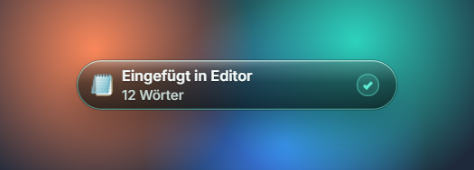

  <picture>
    <source media="(prefers-color-scheme: dark)" srcset="site/bilder/lockup-hell.svg" />
    
  </picture>

<h3 align="center">Sprich einfach. Es steht da.</h3>

  Taste halten, sprechen, loslassen: Letterflow schreibt deinen Text dorthin, wo der Cursor blinkt. 
  Komplett auf deinem Windows-PC, ohne Konto und ohne Cloud.

  <a href="https://github.com/jsteiner4000/Letterflow/releases/latest/download/Letterflow-Setup.exe"><b>⬇&nbsp;&nbsp;Für Windows herunterladen</b></a>
  &nbsp;&nbsp;·&nbsp;&nbsp;
  <a href="https://jsteiner4000.github.io/Letterflow/">Website</a>
  &nbsp;&nbsp;·&nbsp;&nbsp;
  <a href="https://github.com/jsteiner4000/Letterflow/releases">Alle Versionen</a>

  

## So geht's

1. **Rechte Strg halten**, oder zweimal antippen, wenn du freihändig sprechen willst.
2. **Sprechen**, ganz normal, mit Pausen und „ähm“.
3. **Loslassen.** Der Text steht im Textfeld, mit Satzzeichen und deinen Schreibweisen.

## Was Letterflow kann

- **Lokal:** Spracherkennung und Glättung laufen auf deinem Rechner. Kein Konto, kein Server, kein Abo.
- **Glättet:** „ähm“ fliegt raus, Selbstkorrekturen wie „Montag, nein, Dienstag“ werden angewendet.
- **Überall:** Word, Outlook, WhatsApp, Browser: jedes Programm mit Textfeld.
- **Deutsch und Englisch**, auch gemischt im selben Satz.
- **Aktualisiert sich selbst** im Hintergrund.

## Installieren

Den Installer herunterladen und starten, Administratorrechte braucht es nicht. Weil Letterflow noch nicht signiert ist, zeigt Windows eine blaue Warnung: **Weitere Informationen**, dann **Trotzdem ausführen**. Beim ersten Start lädt Letterflow einmalig die Sprachmodelle (ca. 0,7 GB), danach läuft alles offline.

Windows 10 und 11, 64 Bit. Die ausführliche Anleitung mit Hilfe bei Problemen steht in [LIESMICH.md](LIESMICH.md).

---

© 2026 Julius Steiner. Alle Rechte vorbehalten, siehe [LICENSE](LICENSE). Verwendete Bibliotheken und Modelle: [DRITTANBIETER.md](DRITTANBIETER.md).
